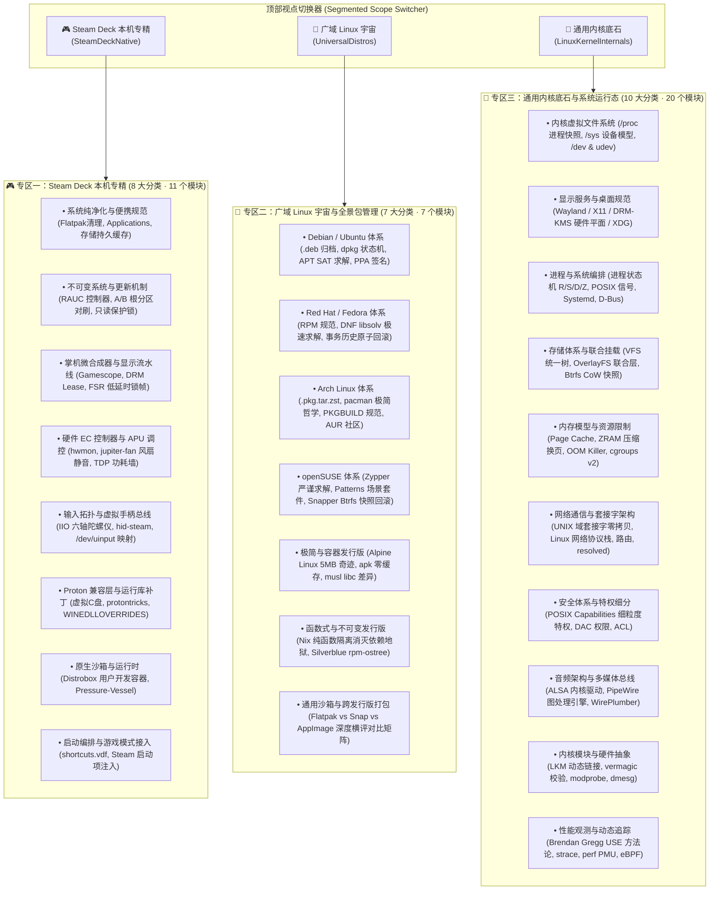

# 🧰 DeckToolBox (Linux 设备体系与内核知识探索中心)

> **基于 C# (.NET 10 + Avalonia 11) 构建的数据驱动型 Linux 系统与掌机架构交互式知识桌面应用**
>
> 💡 **核心指导思想**：
> **拒绝黑盒暗箱操作！拒绝浅尝辄止！严格区分本机与广域 Linux 宇宙！**
> 本项目坚决摒弃“点击一下不知背后修改了什么”的黑盒运维模式。应用采用**动静分流架构**，通过顶部视点选择器，将 **Steam Deck 本机特化机制**、**广域 Linux 发行版与包管理宇宙** 以及 **通用 Linux 内核底石** 彻底解耦独立呈现。应用内每一个子模块均严格遵循四段式结构，将**底层原理 (Why)**、**操作后果与边界 (Consequences)**、**人机交互指令 (Actionable Commands)** 与 **验证手段 (Verification)** 彻底透明摆在阳光下。

---

## 🏗️ 架构升级：三大视点分流与数据驱动 (Segmented Multi-Scope Architecture)

应用采用现代顶部胶囊选择器实现跨维度视点切换，彻底将本机与外部发行版隔离：



---

## 🧭 全景知识体系矩阵汇总 (25 大分类 · 38 个深度模块)

### 专区一：🎮 Steam Deck 本机专精
- **系统纯净化与便携规范**：Flatpak 沙箱清理、`~/Applications` 独立绿色架构、持久日志与着色器缓存清理。
- **不可变系统与更新机制**：SteamOS 3.x 工业级 A/B 根分区对刷、RAUC 控制器、只读保护锁 (`steamos-readonly`) 与持久安全孤岛。
- **掌机微合成器与显示流水线**：Gamescope DRM Lease 独占直通、40/45/60 帧率低延时平滑调度、FSR/NIS 画面缩放着色器、桌面嵌套沙盒。
- **硬件 EC 控制器与 APU 调控**：嵌入式控制器 (EC)、`/sys/class/hwmon` 硬件传感器、`jupiter-fan-control` 智能风扇静音算法、AMD APU 毫瓦级 TDP 功耗墙。
- **输入拓扑与虚拟手柄总线**：Linux IIO 工业陀螺仪传感器采集、`hid-steam` 内核驱动、`/dev/uinput` 虚拟 Xbox 360 手柄合成、蜥蜴模式 (Lizard Mode) 硬件保底。
- **Proton 兼容层与运行库补丁**：虚拟 C 盘 (`compatdata/<appid>/pfx`)、`protontricks` 微软原装 VC++ 运行库注入、`WINEDLLOVERRIDES` 动态链接库劫持与单机 Mod 生效机理。
- **原生沙箱与运行时**：SteamOS 官方预装 Distrobox + Podman 用户免 root 开发容器、Valve 游戏沙箱 Pressure-Vessel。
- **启动编排与游戏模式接入**：非 Steam 应用全屏游戏流接入、`shortcuts.vdf` 二进制格式、Steam 启动项 `%command%` 变量展开与包装器链。

### 专区二：🐧 广域 Linux 宇宙与全景包管理
- **Debian / Ubuntu 体系**：`.deb` Unix ar 归档结构、`dpkg` 状态机、`apt` 的 SAT 依赖图求解、APT Pinning 权重控制与现代 PPA `Signed-By` 签名安全链。
- **Red Hat / Fedora 体系**：`.rpm` 二进制 Header/cpio 结构、SPEC 文件解剖、从 YUM 到 DNF 的 C 语言 `libsolv` 极速求解革命、AppStream 多版本模块流、`dnf history undo` 事务级一键回滚。
- **Arch Linux 体系**：`.pkg.tar.zst` 极致压缩与零延迟解包、pacman KISS 极简哲学、`.pacnew` 三方合并机制、严禁“部分更新 (Partial Upgrades)”铁律、PKGBUILD 声明式构建脚本与 AUR 社区安全审查。
- **openSUSE 体系**：德国工业级稳健标杆、Zypper 离散数学 SAT 求解器、场景化功能套件 Patterns、Snapper 与 Btrfs 原生快照联动（事务前后自动打点，开机 GRUB 界面一键回滚还原系统）。
- **极简与容器发行版 (Alpine Linux)**：云原生时代 5MB 镜像奇迹、`musl libc` 替代 glibc 的关键 ABI 差异、BusyBox 极简用户态工具、`apk add --no-cache` 零缓存黄金构建规范。
- **函数式与不可变软件分发 (Nix / NixOS)**：纯函数式构建模型、`/nix/store/<hash>-<name>` 内容寻址彻底消灭“依赖地狱”、多版本绝对隔离并行共存、NixOS 声明式全系统配置与原子代际秒级回滚、Fedora Silverblue `rpm-ostree`。
- **通用沙箱与跨发行版打包深度横评**：Flatpak (OSTree + Bubblewrap 命名空间隔离) vs Snap (SquashFS 镜像 + Loop 设备 + AppArmor) vs AppImage (单文件绿色自解压 FUSE 挂载) 全维度技术选型横评。

### 专区三：🧠 通用内核底石与系统运行态
- **内核虚拟文件系统**：`/proc` 进程快照与 sysctl 动态调优；`/sys` kobject 设备驱动模型与电源接口；`/dev` 字符/块设备与 udev 动态规则 (`uaccess` 免 root ACL)。
- **显示服务与桌面规范**：Wayland 协议演进、DRM/KMS 硬件平面、FreeDesktop XDG 目录与桌面菜单规范。
- **进程与系统编排**：进程状态机 (R/S/D 不可中断等待/Z 僵尸进程)、POSIX 异步信号、Systemd 单元依赖拓扑与 D-Bus 进程间通信总线。
- **存储体系与联合挂载**：VFS 统一目录树、只读挂载保护、OverlayFS 联合分层挂载与 Btrfs 现代写时复制 (CoW)。
- **内存模型与资源限制**：Linux 虚拟内存模型、Page Cache 与脏页回写、ZRAM 内存压缩换页、Linux OOM Killer 与 cgroups v2 统一层级资源硬限制。
- **网络通信与套接字架构**：UNIX 域套接字 (AF_UNIX) 绕过协议栈的零拷贝 IPC、Linux 网络协议栈、现代 iproute2 (`ip` / `ss`)、网络命名空间与 systemd-resolved DNS 链。
- **安全体系与特权细分**：POSIX Capabilities 权能拆解 (`CAP_SYS_NICE` 实时防卡顿调度、`CAP_NET_BIND_SERVICE`)、Inode 12 位权限位图、SUID/SGID/Sticky 粘滞位语义与 POSIX ACL 细粒度授权。
- **音频架构与多媒体总线**：Linux 二十年音频演进史 (ALSA -> PulseAudio/JACK -> PipeWire)、PipeWire 纳秒级 `memfd` 共享内存图处理引擎与 WirePlumber 会话管理。
- **内核模块与硬件抽象**：可加载内核模块 (LKM) 动态链接、`/lib/modules` 依赖树、`vermagic` 符号防篡改 CRC 校验、modprobe 拓扑加载与 dmesg 环形缓冲区排障。
- **性能观测与动态追踪**：跳出“仅看 CPU 使用率”的初级误区，深入 Brendan Gregg USE 性能分析哲学、`/proc/loadavg` 包含 D 状态 (IO 等待) 的真相、strace 系统调用拦截、CPU 硬件 PMU 性能计数器与 eBPF 零开销内核追踪。

---

## 🚀 启动与使用

在终端进入工程根目录，执行本地启动脚本即可打开图形界面：

```bash
cd /home/deck/Games/DeckToolBox
./run.sh
```

- **顶部胶囊切换**：随时在 `🎮 Steam Deck 本机专精`、`🐧 广域 Linux 宇宙` 与 `🧠 通用内核底石` 之间一键切换。
- **透明人机操作**：所有卡片中的命令均支持点击【复制指令】，由您亲自粘贴至 Konsole 终端中审核并执行，实现纯透明人机交互。
